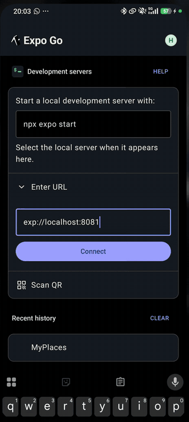

# MyPlaces

Aplicación móvil hecha con React Native y Expo para consultar, añadir, guardar y eliminar lugares de interés.
Los lugares se guardan en el propio dispositivo y se recuperan al reiniciar la app.

Práctica 2 · UT2 / RA2 · Programación multimedia y dispositivos móviles.

> [!NOTE]
> **Estado: práctica completa.** Hechos: navegación, formulario con validación, persistencia local con
> posibilidad de eliminar, consulta a una API pública, ubicación con permisos, estado de la conexión
> y gestión de la lista vacía (apartados A a F), y las cinco pruebas con sus evidencias (G).

## Inicio rápido

```bash
npm install
npx expo start
```

Después, desde la terminal de Expo:

- pulsa **`w`** para abrirla en el navegador,
- pulsa **`a`** (Android) o **`i`** (iOS) para abrirla en un emulador,
- o escanea el código QR con la app **Expo Go** desde el móvil.

### Requisitos

- **Node.js 22.13 o superior** (también valen 24.3+ y 26+). Con versiones anteriores, Expo SDK 58 no arranca.
- `npm`.
- La app **Expo Go** en el móvil (en la misma red wifi que el ordenador) o un emulador de Android o iOS.

> [!TIP]
> Si algo no se actualiza, reinicia limpiando la caché con `npx expo start -c`.
> Si el móvil no conecta, comprueba que está en la misma red y que el firewall del ordenador permite el puerto
> que usa Expo (por defecto `8081`).

## Qué hace

| Apartado | Funcionalidad | Estado |
|---|---|---|
| A | Menú con la lista de lugares, pantalla de detalle y `id` de cada lugar | Hecho |
| A | Componentes reutilizables: `BotonPlaces`, `TituloPlace`, `SelectorColor` | Hecho |
| B | Formulario «Nuevo lugar» (título, subtítulo, descripción y color). No deja guardar un título vacío | Hecho |
| C | Persistencia con AsyncStorage: los lugares se recuperan al reiniciar | Hecho |
| C | Eliminar un lugar, con confirmación | Hecho |
| C | Mensaje cuando la lista está vacía: «Aún no hay lugares. ¡Añade el primero!» | Hecho |
| D | Pantalla «Descubre»: busca lugares por nombre con `fetch` y muestra los estados de carga, error y sin resultados | Hecho |
| E | Pantalla «Mi ubicación»: botón que pide permiso y muestra la ubicación y las coordenadas. Si se deniega, avisa y el resto de la app sigue funcionando | Hecho |
| F | Barra con el estado de la conexión y el tipo de red (NetInfo). Sin conexión, «Descubre» no lanza consultas y avisa | Hecho |
| G | Pruebas (cinco casos) y capturas | Hecho |

No tiene servidor ni cuenta de usuario: los datos viven solo en el dispositivo donde se crean.

## Estructura del proyecto

```text
src/
├─ app/                       pantallas (cada fichero es una ruta, con Expo Router)
│  ├─ _layout.jsx             marco de la app: navegación en pila y estilo de la cabecera
│  ├─ index.jsx               menú con la lista de lugares (ruta "/")
│  ├─ nuevo.jsx               formulario para añadir un lugar (ruta "/nuevo")
│  ├─ descubre.jsx            buscador de lugares con una API pública (ruta "/descubre")
│  ├─ ubicacion.jsx           ubicación actual con petición de permiso (ruta "/ubicacion")
│  └─ place/[id].jsx          detalle de un lugar, con botón de eliminar (ruta "/place/<id>")
├─ components/                piezas reutilizables
│  ├─ BotonPlaces.jsx         botón de un lugar (título, subtítulo y color)
│  ├─ TituloPlace.jsx         título del menú
│  ├─ SelectorColor.jsx       fila de círculos para elegir un color
│  └─ BannerRed.jsx           barra con el estado de la conexión y el tipo de red
├─ hooks/
│  └─ useRed.js               hook que informa de si hay conexión y de qué tipo (NetInfo)
├─ data/
│  └─ places.js               lugares de ejemplo, usados la primera vez que se abre la app
└─ storage/
   └─ placesStorage.js        leer, guardar y eliminar lugares con AsyncStorage
```

## Persistencia

Los lugares se guardan con [AsyncStorage](https://react-native-async-storage.github.io/async-storage/) bajo una sola clave,
como una lista convertida a texto (`JSON`).

- La **primera vez** que se abre la app no hay nada guardado y se muestran los lugares de `data/places.js`.
- Al **crear o eliminar** un lugar se guarda la lista completa.
- Al **volver al menú** se vuelve a leer la lista (`useFocusEffect`), así que los cambios se ven sin recargar.
- Si se eliminan todos los lugares, la lista queda vacía y los de ejemplo **no** reaparecen.

| Función (`src/storage/placesStorage.js`) | Qué hace |
|---|---|
| `readPlaces()` | Devuelve la lista guardada, o los lugares de ejemplo la primera vez |
| `savePlaces(lista)` | Guarda la lista completa |
| `deletePlace(id)` | Elimina el lugar con ese `id` |

## API pública utilizada

**[Open-Meteo Geocoding API](https://open-meteo.com/en/docs/geocoding-api)**, que busca lugares por nombre.
No necesita clave ni registro y se usa en la pantalla «Descubre» (`src/app/descubre.jsx`).

```text
GET https://geocoding-api.open-meteo.com/v1/search?name=Barcelona&count=10&language=es&format=json
```

| Parámetro | Valor | Para qué |
|---|---|---|
| `name` | texto buscado | Nombre del lugar. Mínimo 2 letras, por eso el botón «Buscar» se desactiva con menos |
| `count` | `10` | Número máximo de resultados |
| `language` | `es` | Idioma de los nombres |
| `format` | `json` | Formato de la respuesta |

Cada resultado incluye `name`, `admin1` (comunidad o región), `country`, `latitude` y `longitude`.

Estados de la pantalla:

| Estado | Cuándo | Qué se muestra |
|---|---|---|
| Inicial | Aún no se ha buscado | Instrucción para escribir y buscar |
| Cargando | Mientras responde la API | Rueda de carga |
| Con resultados | Respuesta con lugares | Lista de tarjetas con nombre, zona y coordenadas |
| Sin resultados | La API responde sin lugares | «No hay resultados para …» (la API omite entonces el campo `results`) |
| Error | Sin internet, o la API responde con un código de error | Mensaje y botón «Reintentar» |

## Permisos y limitaciones

### Conectividad

La barra inferior (`BannerRed`, colocada en `_layout.jsx` para verse en todas las pantallas) usa
[`@react-native-community/netinfo`](https://github.com/react-native-netinfo/react-native-netinfo) a través del hook `useRed`,
y se actualiza sola cuando la red cambia.

| Situación | Barra | Qué hace «Descubre» |
|---|---|---|
| Wi-Fi, datos móviles, Ethernet… con internet | «Conectado · Wi-Fi» (o el tipo que sea), en verde | Funciona con normalidad |
| Sin conexión (modo avión, sin red) | «Sin conexión a internet», en rojo | El botón «Buscar» se desactiva, **no se lanza la petición** y se muestra un aviso |
| Conectado a una red sin salida a internet | «Sin conexión a internet» | Igual que sin conexión |

Si la conexión se pierde justo durante una búsqueda, la petición falla y se muestra el estado de error con «Reintentar».

### Permiso de ubicación

La pantalla «Mi ubicación» (`src/app/ubicacion.jsx`) usa [`expo-location`](https://docs.expo.dev/versions/latest/sdk/location/)
y pide el permiso **solo cuando se pulsa el botón** y **solo mientras la app está abierta** (permiso en primer plano).
En `app.json` el plugin `expo-location` declara el texto del permiso y los permisos de Android (`ACCESS_COARSE_LOCATION` y `ACCESS_FINE_LOCATION`).

| Situación | Qué ocurre |
|---|---|
| El usuario acepta | Muestra la ubicación (dirección, si se puede obtener), latitud, longitud y precisión |
| El usuario deniega | Muestra un mensaje y, en el móvil, un botón «Abrir ajustes». El resto de la app sigue funcionando |
| Hay permiso pero falla el GPS (apagado, sin señal) | Muestra un mensaje de error |
| No se puede obtener el nombre del lugar (sin internet, versión web) | Muestra las coordenadas y «Nombre del lugar no disponible» |

> [!NOTE]
> En la versión web el navegador pide su propio permiso, y el nombre del lugar no suele estar disponible.
> En un emulador hay que fijar una posición falsa: en Android, *Extended controls → Location*; en iOS, *Features → Location*.

Limitaciones conocidas:

- Los datos son **locales a cada dispositivo**: no se comparten entre móviles ni entre el navegador y la app.
- En la versión web, los datos se guardan por dirección: `localhost:8081` y `localhost:8082` son sitios distintos.
- Los lugares de ejemplo no se pueden restaurar desde la app una vez eliminados.
- La pantalla «Descubre» necesita conexión a internet. La API es gratuita para uso no comercial; consulta sus condiciones y límites en su web.
- Los resultados de «Descubre» solo se muestran: todavía no se pueden añadir a «Mis lugares».
- NetInfo comprueba si hay salida real a internet con una petición de prueba en segundo plano, así que en algunas redes (portales cautivos, cortafuegos) puede tardar unos segundos en reflejar el cambio.
- En «Mi ubicación», el **nombre del lugar** puede no estar disponible aunque las coordenadas sean correctas. Las coordenadas
  las da el GPS, pero el nombre lo resuelve `reverseGeocodeAsync` con un servicio del propio dispositivo, que no existe en
  la versión web y puede faltar en algunos emuladores o sin conexión a internet. En esos casos la app muestra las coordenadas
  y el aviso «Nombre del lugar no disponible».

## Pruebas

Cinco casos del apartado G, probados en un **móvil Android con Expo Go** el 13/11/2026. Las evidencias están en [`Pruebas/`](Pruebas/).

| # | Caso | Cómo se provoca | Resultado esperado | Resultado obtenido | Observaciones |
|---|---|---|---|---|---|
| 1 | Creación | Añadir un lugar válido desde «Añadir lugar» | Aparece en el menú | Correcto: «Central City» (con subtítulo, descripción y color rojo) aparece en el menú | Capturas 2 a 4 del PDF |
| 2 | Reinicio | Cerrar la app del todo y volver a abrirla | El lugar creado sigue ahí | Correcto: tras cerrar la app y abrirla de nuevo, «Central City» sigue en el menú | Vídeo y GIF de la carpeta `Pruebas/` |
| 3 | Sin datos | Eliminar todos los lugares (uno a uno, desde su pantalla de detalle) | El menú muestra «Aún no hay lugares. ¡Añade el primero!», sigue siendo usable y el botón «Añadir lugar» funciona | Correcto: el menú muestra «Aún no hay lugares. ¡Añade el primero!» y los botones «Añadir lugar», «Descubre» y «Mi ubicación» siguen ahí | La captura es del menú sin lugares; se llegó a este estado borrando todos |
| 4 | Error de red | Activar el modo avión y abrir «Descubre» | La barra dice «Sin conexión a internet», «Buscar» queda desactivado y se avisa; no se lanza ninguna petición | Correcto en parte: con el modo avión, la barra roja dice «Sin conexión a internet» | La captura es del menú. No se capturó «Descubre» sin conexión, así que el botón «Buscar» desactivado no está documentado con imagen |
| 5 | Permiso denegado | Pulsar «Utilizar mi ubicación» en «Mi ubicación» y denegar | Mensaje, y el resto de la app sigue usable | Correcto: tras denegar, aparece «Permiso de ubicación denegado…» y el botón «Abrir ajustes» | También se probó con el permiso concedido: muestra la ubicación y las coordenadas (ocultas en la captura) |

## Capturas

Las evidencias de las pruebas están en la carpeta [`Pruebas/`](Pruebas/):

| Fichero | Contenido |
|---|---|
| [`Pruebas-MyPlaces.pdf`](Pruebas/Pruebas-MyPlaces.pdf) | Informe con las cinco pruebas y sus capturas dentro de un móvil |
| [`Screenrecorder-2026-11-13-20-03-21-987.mp4`](Pruebas/Screenrecorder-2026-11-13-20-03-21-987.mp4) | Vídeo de la prueba de persistencia: la app se vuelve a abrir y el lugar creado sigue en el menú |
| [`reinicio-app.gif`](Pruebas/reinicio-app.gif) | El mismo vídeo en GIF |
| [`capturas/`](Pruebas/capturas/) | Las capturas originales de pantalla |

Prueba de persistencia: se crea un lugar, se cierra la app del todo y se vuelve a abrir. El lugar sigue en el menú. En la captura de «Mi ubicación» se ha ocultado la dirección y las coordenadas.



## Tecnologías

- [Expo](https://docs.expo.dev/) SDK 58 y [Expo Router](https://docs.expo.dev/router/introduction/) (navegación basada en ficheros)
- React Native 0.88 y React 19
- `@react-native-async-storage/async-storage` para la persistencia local
- `expo-location` para la ubicación
- `@react-native-community/netinfo` para el estado de la conexión
- JavaScript (`.js` y `.jsx`)

## Documentación de apoyo

En `Practica2-MyPlaces/` hay dos apuntes en HTML, con explicaciones y simulaciones:

- `apuntes-expo.html`: guía del proyecto paso a paso (apartados A a G).
- `react-native-basico.html`: principios de React Native y de sus componentes.
